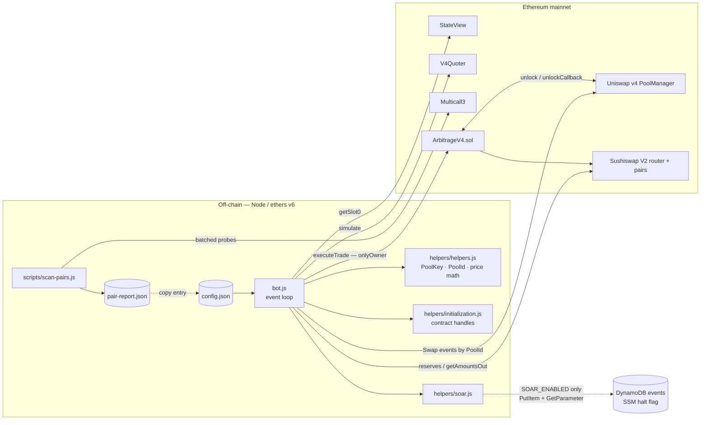
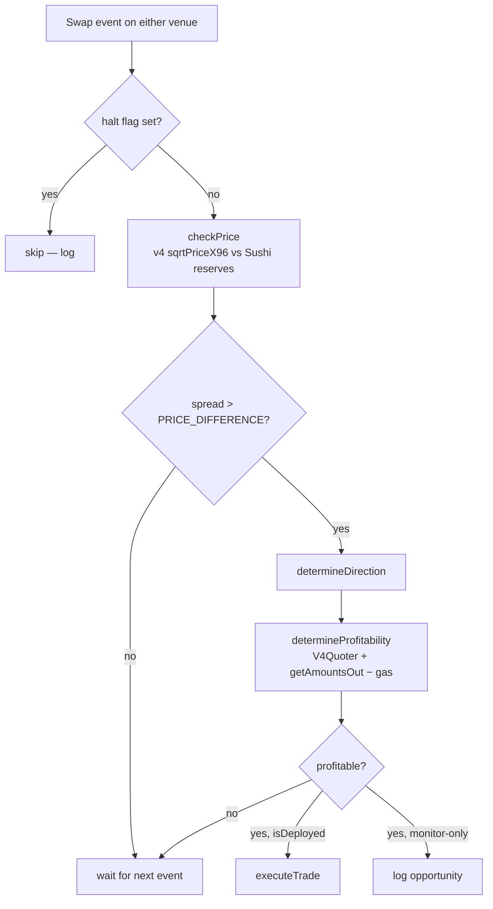
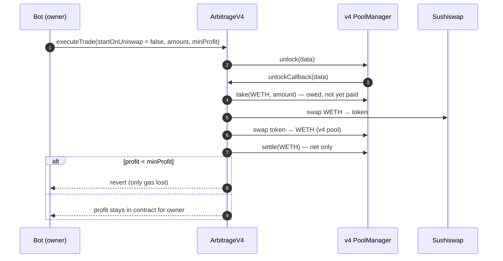

# Architecture

Diagrams for the Uniswap v4 ↔ Sushiswap arbitrage bot. The README has the design narrative. This page is the visual reference.

## Components

## Decision loop

## Atomic execution — start on Sushiswap

Starting on Uniswap mirrors this: the v4 swap itself acts as the loan and is settled after the Sushiswap leg.
